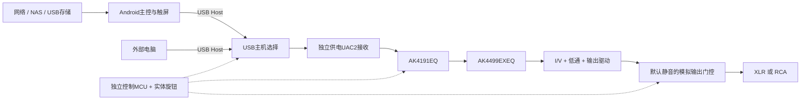

# 家用流媒体播放器整机设计提案

日期：2026-10-23；状态：供用户审核，未批准电路实施或采购。

2026-10-25用户批准继续推进，现已编写[分包实施计划](../plans/2026-10-25-streamer-implementation.md)。该批准用于推进当前设计及电池策略的工程规划，不将尚缺的芯片参数、详细保护电路或实测结果视为已冻结，也不作为采购或打样授权。以下推荐项通过对应工程包闭合。

2026-10-24电源需求已变更：内置电池、正常播放电池优先、低电量允许充电输入参与供电、屏幕常亮续航至少1小时、电脑USB不供电。第6节已更新工作策略，电池选型、充电器、电源器件、热预算和实施方案仍待设计评审；本稿不是电源施工依据。原一万元预算分配亦须重估。

## 1. 设计目的与边界

在一万元首版整机预算内，完成可接纯后级的 Android 流媒体播放器：触摸屏、实体音量旋钮、手机辅助控制，XLR/RCA 默认选择一路输出。电脑 USB DAC 模式在 Android 关闭时仍须独立工作且不依赖电脑供电。整机内置电池，正常播放电池优先，屏幕常亮续航至少1小时；低电量允许充电输入参与供电。电源、时钟、DAC、I/V、滤波和保护由本项目设计；主控使用现成计算平台。机壳使用 Blender 与分件3D打印。

已确认需求以[澄清记录](../../design-clarifications.md)及[音频验收基线](../../audio-acceptance.md)为准。本提案中的新选择均标为“推荐”，不能与已确认需求混同。最终最低音频指标为XLR SNR ≥123dBA、THD+N ≤0.0002%，设计目标为≥128dBA、≤0.0001%；这些不代表现有工程实测结果。

不纳入首版的已确认项目：机内SSD、光纤/同轴/HDMI ARC输入、电视盒子与智能家居功能。GPIO I²S保留为备选，不同时开发两套内置播放路径。

## 2. 推荐整体方案

推荐使用现成树莓派5作为台架首选，先评估8GB版本与平板式Android；容量和镜像最终以应用实测及预算确定。保留更换计算平台的空间。推荐沿用现有工程的AK4191EQ＋AK4499EXEQ方向，不改用架构不同的AK4499EQ；芯片与供应渠道正式选型另行审核。

USB优先是为了主控解耦和电脑输入复用，不承诺它比GPIO音质好。两个USB主机轮流访问同一音频设备，禁止直接并联；D+/D−选择、VBUS检测及防回灌分别设计。首版推荐固定设备角色的外部USB-B接口，减少USB-C角色与供电协商的额外范围，最终外观可在接口评审时调整。

## 3. 模块划分与接口

| 模块 | 推荐实现与职责 | 接口及设计界限 |
| --- | --- | --- |
| 主控/显示 | 现成Pi5、microSD系统存储、约7英寸横屏候选、散热组件 | 对音频仅提供USB数据及控制请求；不负责最终输出保护；microSD与被排除的音乐SSD区别对待 |
| 音频板 | USB接收、时钟分配、AK4191、AK4499EX、I/V/滤波及输出 | 优先将短距离数字音频和敏感模拟链留在同板分区，明确回流路径；是否加隔离须有实际问题和预算依据 |
| 电源/控制板 | 独立MCU、旋钮、选源、音量状态、欠压及故障检测 | 与主控电源域分离，电脑DAC模式不依赖Android；音频电源时序由该模块管理 |
| 面板/结构 | 屏幕、旋钮、电源键、输入选择、状态指示 | 屏幕关闭时仍有音源和静音状态提示；打印件分件后仍保持连接器和板卡定位 |

MCU与主控的通信协议须包含版本、状态读回、请求序号和超时；物理UART/USB等接口在电平与断电防回灌核查后选择。主控提出请求，MCU返回实际状态，界面不得将未执行请求显示为已生效。MCU调试/升级入口保持可恢复，升级期间禁止开放模拟输出。

## 4. 时钟、DAC及音量

推荐让音频子系统使用本地音频时钟，按44.1k和48k采样率系列选择时钟配置。AK4191与AK4499EX的MCLK必须满足官方同步要求；输入接口的异步工作与两颗芯片的时钟关系分开设计。晶振频率、数量、分频和切换时序应根据所选USB固件与AKM模式计算后冻结，不能单凭已有CCHD-957符号决定。

优先核查官方应用说明Case2的共同基准同步路径（22.5792/24.576MHz系列），前提是USB接收器固件能配合该时钟；若不能，比较Case1本地单基准异步输入方案，并重新审核格式覆盖与输入数据同步行为。两者尚未冻结，详见约束表，不能任意混接。

首版推荐以AK4191数字衰减作为主音量的首选验证路径，独立MCU为音量状态的唯一权威，配合默认静音的模拟输出门控。此选择尚不能证明常用小音量下的噪声和匹配合格；若小音量实测失败，须在布局冻结前比较模拟/混合衰减，不在成板后无条件补救。

所有音源经过同一主音量与上限。系统/App音量可以进一步衰减，但不能绕过整机上限；对USB主机音量指令应先核清接收固件行为再定义映射。禁止将Android音量百分比直接当作整机dB值。首版禁止启用AK4191的DSD音量旁路（DSDD=1）；只有另行审核并验证独立音量限制路径后才可开放。普通DSD输入是否支持与音量旁路分开验证；已接受的DSD转PCM路径也必须验证增益和切换静音。

本地规格依据：

- [AK4191手册](https://www.akm.com/content/dam/documents/products/audio/audio-dac/ak4191eq/ak4191eq-en-datasheet-myakm.pdf)第53页§9.1.3、第78页§9.6：DSD旁路与音量、硬复位默认衰减。
- [AKM应用说明](https://www.akm.com/content/dam/documents/products/audio/audio-dac/ak4191eq/ak4191eq-en-designtransition-myakm.pdf)第3页：两器件MCLK同步约束。
- [AK4499EX手册](https://www.akm.com/content/dam/documents/products/audio/audio-dac/ak4499exeq/ak4499exeq-en-datasheet-myakm.pdf)中的接口、上掉电、I/V与静音条款；逐项对照见[约束表](../../akm-design-constraints.md)。

## 5. 运行状态与纯后级保护

| 状态 | 允许行为 | 模拟输出 |
| --- | --- | --- |
| 待机/控制器复位 | 接受开机、模式选择 | 保持硬件默认静音 |
| 初始化 | 建立电源、时钟，配置DAC和音量并读回 | 静音，不依赖器件复位音量 |
| 就绪但未播放 | 显示/指示输入和主音量，等待有效音频 | 默认静音 |
| Android播放 | 仅选中内置USB主机 | 满足条件后渐变开放 |
| 电脑DAC | 主控可断电；独立MCU和音频板运行 | 同一音量与保护策略 |
| 切源/切采样率 | 先静音，停流、切换、重新枚举/建立时钟、读回配置 | 全过程受控静音，完成后恢复受限音量 |
| 故障/欠压/更新 | 记录原因，拒绝自动恢复满幅输出 | 进入可验证的故障静音状态 |
| 关机 | 先静音，再按DAC/I/V约束关闭各电源 | 主控安全关机与音频时序分别处理 |

首次使用默认保持静音，设置下游增益相关的启动音量和最大音量后才能开放输出。建议随后开机不自动播放；恢复音量取上次设置与启动上限的较低者。恢复失败、读回失败或配置损坏时保持静音。功放型号未定，因此本提案不声称某个固定dB值对所有后级都安全。

对模拟门控、控制器复位、电源失效和时钟丢失分别提出故障覆盖要求；不能只用Android心跳覆盖全部故障。信号继电器/模拟开关、欠压监控及独立硬件门控的具体器件尚须官方资料和电气评估，不在本提案中假定已满足。

Android失联的处理必须区分模式：内置播放模式按定义进入保护；电脑独立模式允许Android关机，不能因此误触发持续静音。输出是否就绪仍由独立控制器、音频接口和电源状态判断。具体故障检测和恢复时间在器件时序预算后给出，不能以任意固定延迟代替状态验证。

## 6. 电源与结构

### 6.1 已确认的电池优先策略

内置电池是正常播放的主要能源，插入外部充电电源不自动切换到适配器播放。用户接受电池因未插电使用而低电量时，充电输入参与系统供电以维持播放。电脑USB不为整机供电或充电，仍保留音频与必要的VBUS状态检测。以下具体状态控制为推荐设计，尚未接受电路实现。

| 工况 | 推荐电源行为 | 必须验证 |
| --- | --- | --- |
| 正常播放、电量充足，插电或未插电 | 电池供各稳压支路；充电功率路径实际断开 | 充电器是否仍经系统路径送电，接地与信号线耦合是否影响模拟指标 |
| 低电量且充电输入有效 | 限流充电播放，允许输入参与供电；能力不足时优先保播放并减少充电 | 输入功率、升温、各轨稳定、噪声及电量是否真正恢复 |
| 电量恢复 | 按上下限及滞回重新回到电池优先播放 | 防止频繁切换；恢复过程中不爆音、不重启；评估循环寿命 |
| 停止播放/关机且插电 | 允许按电池规格正常充电；完成后按策略停止 | 电池温度、均衡/保护、终止判断及储存电量策略 |
| 未插电且接近低电量关机线 | 提示、静音、执行主控安全关机及音频掉电顺序 | 在电池保护板硬切断之前完成，不以深度过放换取续航 |
| 电量不足以启动且插入充电器 | 先建立控制和充电，满足启动条件后再开放播放 | 不承诺空电池立即开机；保护锁定/异常电池的行为另行定义 |

“停止充电”不必然断开适配器对SYS的供电；普通充电芯片的NVDC/Power Path不能自动实现上述纯电池状态。已归档[BQ25798手册](https://www.ti.com/lit/ds/symlink/bq25798.pdf)第39～40页§7.3.8可用于比较电源路径机制，它不是已选芯片。纯电池、充电播放与充电转换过程须分别验收；电池本身不会消除内部转换器、USB或功放接地引入的干扰。

### 6.2 容量与电源域

屏幕常亮、正常播放的纯电池续航至少1小时。先测量/核算所有负载，再以Wh选择电池，不以不同电压下的mAh直接比较。试算30～40W负载、85%转换效率及80%可用容量时，标称能量约44～59Wh；这些均为未验证的规划假设，60～80Wh只是候选评估区间，不是冻结容量或续航保证。额外考虑老化、温度、启动峰值、截止电压及安全关机余量，避免将同一余量重复计算。

电池体系、串并数、完整电池包、保护/均衡、温度与电量监测、充电功率及允许周期尚未确定。推荐优先评估带明确原厂规格和保护方案的电池包，而非先固定裸电芯数量。充电、电源转换和保护核心器件必须按确切型号先归档完整官方资料。推荐220V转换仍留在外置合规适配器内，机内只处理低压直流；这一物理布置和新增成本随电源包审核。

外部充电电压和额定功率要在各轨电流、启动峰值、充电功率及热预算之后选定。台架可以暂用独立的官方主控适配器与限流音频电源，不把实验供电冒充最终方案。

电源树分三域：始终可用的控制电源；可独立启停的主控/屏幕电源；按序控制的USB、时钟、AKM及模拟正负电源。接口需检查已关电模块经USB/UART/控制引脚被反向供电的情形。LT3045仅在其官方输入范围和正向稳压用途内评估，不能直接代替负电源稳压器，也不能省略压差、耗散、稳定性和输入故障检查。

Pi5供电与USB外设电流限制按[本地官方电源章节](https://raw.githubusercontent.com/raspberrypi/documentation/master/documentation/asciidoc/computers/raspberry-pi/power-supplies.adoc)核对；LDO约束按[LT3045完整手册](https://www.analog.com/media/en/technical-documentation/data-sheets/LT3045.pdf)评估。DC/DC、负轨及保护器件在未下载对应完整规格前不进入电路设计。

机壳最大300×250×120mm，打印单件不超过200×200×200mm。推荐分件外壳配独立刚性安装底板，接口受力不传给细小焊点。材料、局部金属屏蔽、散热器与低转速风扇由温升和噪声验证决定；不以塑料机壳替代屏蔽或散热设计。屏幕、开孔与散热空间定型后才冻结PCB板形。

内置电池新增固定、防磨损、温度监测及与热源隔离的设计要求；打印件选材、布置和维护可达性应按选定电池规格重新评审。加入电池后不得沿用旧功耗、空间或热设计作为通过证据。

## 7. 核心候选与资料门槛

| 功能 | 推荐候选/方向 | 本阶段结论 |
| --- | --- | --- |
| 数字前端/DAC | AK4191EQ＋AK4499EXEQ | 优先沿用；完整规格已归档，现有符号和电路须逐项审核 |
| USB接收 | XU316系列 | 芯片完整规格已归档；封装、时钟及固件覆盖尚未冻结，软件指南缺口必须解决 |
| 音频晶振 | CCHD-957系列 | 完整规格已归档；完整订货号及频率由时钟表确定 |
| 正向低噪声稳压 | LT3045 | 已归档，使用范围由电源与热预算决定，不默认五颗均应保留 |
| I/V与滤波 | OPA1612候选 | 仅在完整官方规格、DAC负载/共模、稳定性和噪声失真预算核对后接受 |
| USB数据选择 | TS3USB221A候选 | 不承担VBUS选择或隔离；带宽、失效状态和断电行为须审核 |
| 独立控制器 | STM32G0B1候选 | 精确封装、供电域、GPIO及看门狗/复位方案须确认；按实际需求可缩减 |
| 电源转换/负轨/门控 | 尚未指定准确料号 | 必须先形成负载及故障预算，再下载官方规格进行候选评估 |

“候选”不是采购批准。[规格库](../../specs/README.md)内不得用product brief代替完整电气规格。当前没有完整BOM或报价；没有证据时不能声称现有器件可直接达到整机指标。

本轮已新增归档[OPA1612](https://www.ti.com/lit/ds/symlink/opa1612.pdf)、[TS3USB221A](https://www.ti.com/lit/ds/symlink/ts3usb221a.pdf)、[STM32G0B1系列](https://www.st.com/resource/en/datasheet/stm32g0b1cb.pdf)完整官方规格。OPA1612有AKM应用说明第20页§7.2推荐依据，但该说明的实测表述针对OPA1611，不能当作本项目OPA1612指标证据。控制器参考手册、勘误和相关固件资料须在固件实施前补齐。完整限制见[候选评估](../../control-analog-candidates.md)。

## 8. 软件与音源边界

以[音源矩阵](../../reference-source-matrix.md)逐项验证对标音源，允许App实现可访问、可播放；原生集成、Roon Ready和各类Connect认证能力分别报告。所有项目实现状态仍为未验证。无法实现的项目须交用户决定是否接受，不静默删除。

手机辅助控制推荐首版限于局域网查看整机状态、调主音量/静音、选择内置/电脑输入和请求安全关机；不默认包括任意第三方App的搜索、播放队列、屏幕镜像或跨服务统一曲库。蓝牙输入、USB光驱播放/抓轨、12V Trigger仍是待用户决定的范围，详见第11节。

网页服务推荐由Android主控托管，所以主控关闭时手机网页和触屏不可用，仅保留独立实体控制及状态指示；不新增独立联网控制器。若要求关主控后仍有手机控制，则需要另行审核联网架构与预算。

平台验证遵循[台架验证方案](../../platform-validation-plan.md)。Android USB的实际采样率、混音、通知抢占和音量路径必须逐App取证；DAC显示采样率不等于逐比特未修改。

## 9. 验证与放行条件

1. **播放平台通过**：固定镜像、主板、屏幕与现成USB DAC，取得音源矩阵、实际输出格式及24小时稳定性证据；不通过则先解决平台，不制作完整音频PCB。
2. **音频/控制台架通过**：验证选源、复位音量、DSD转换、保护时序及主控断电后电脑独立工作；高规格格式逐项取证。必须故障注入独立MCU硬复位、AK4191 PDN复位和直接拔适配器：0dB默认状态下模拟输出不得提前开放，异常掉电也须保证I/V先于EX失电。
3. **原理图可审**：逐核心器件列本地资料页码、引脚/封装对照、电源/时钟预算和故障响应；ERC、网表及人工审查均有证据。
4. **布局可审**：核查回流、去耦、时钟、USB、模拟布局、机械装配与散热，完成DRC及生产检查。
5. **整机验收**：满足已确认XLR最低指标，报告对标差距；覆盖RCA、低音量、切源、插拔、重启、欠压、控制故障及最终机壳内测试。

推荐测量协议起点：XLR满幅4Vrms、RCA满幅2Vrms、10kΩ负载；THD+N按1kHz、20Hz–20kHz测量带宽、不计权，SNR单列A计权并验证自动静音行为。XLR负载跨差分两端，RCA负载对信号地。该协议是待审核的项目定义，不是芯片保证值，也不等同于厂商宣传条件。另测−20/−40/−60dB音量下的输出、残余噪声与声道差；具体通过限值需结合电平预算和后级兼容范围先定后测。

测量仪器残余、接线与不确定度须支持结论；能力不足记为无法验证。DC偏置、静音瞬态和低音量限值未闭合前，不放行纯后级直连实用验收。推荐24小时为初步检查，最终整机另做72小时连续运行及重复开关/切源测试，循环次数在正式验证计划中冻结。

电路实施前必须提交时钟关系表：USB UAC2反馈与实际音频时钟的关系、桥端BICK/LRCK与AK4191 MCLKI的关系、AK4191与EX的共同基准、选定模式及对应切换序列。USB异步反馈与AK4191异步输入不能相互替代证明；若选择后者，不承诺输入样本未经变换。供电/音频信号在各模块关电时的防回灌表也必须关闭。

## 10. 预算控制建议

以下为加入电池前的分配草案；电池包、充电、保护/监测及新增结构成本尚未核入，须在电源包设计时重新分配。一万元整机上限保持不变；本表不能视作已满足新需求的预算证明。

以下仅为一万元内部预算分配上限，不是市场报价或采购清单，需以供应商报价和BOM核对。

| 类别 | 分配额度（元） |
| --- | ---: |
| 主控、屏幕、存储及散热 | 1800 |
| USB接收、时钟及接口 | 800 |
| DAC、I/V、滤波与模拟输出 | 2300 |
| 电源、控制及保护 | 1200 |
| PCB、贴片及再次打样 | 2000 |
| 机壳、结构、连接与线材 | 700 |
| 项目机动余量 | 1200 |
| 合计 | 10000 |

功放、音箱和通用测试仪器按已确认约定另计。任何类别超支都应重估总额和修板余量；不以删除认证/音源或降低模拟验收线来隐性平衡预算。

## 11. 本轮请审核的决策包

| 决策 | 推荐 | 当前状态 |
| --- | --- | --- |
| DAC具体方向 | 沿用AK4191EQ＋AK4499EXEQ，先审核现有工程 | 推荐，未批准选型 |
| 主控和交互 | Pi5台架、约7英寸横屏、实体旋钮；手机提供整机基本控制 | 推荐，未实测 |
| 音量架构 | AK4191数字衰减先验证＋独立MCU＋默认模拟静音，低音量结果决定是否升级混合衰减 | 推荐，未批准电路 |
| 蓝牙音频输入 | 不列首版放行条件，作为后续增强；若用户需要则加入台架矩阵 | 待用户决定，不改变原音源目标而不报告 |
| USB光驱/抓轨 | 后续增强，首版先覆盖NAS/USB存储 | 待用户决定 |
| 12V Trigger输出 | 预留结构/控制扩展空间，首版暂不装 | 待用户决定 |
| 首次启动和恢复 | 初次保持静音，完成上限设置；之后不自动播放，按受限音量恢复 | 推荐，待确认 |
| 满幅及测量协议 | 4Vrms XLR/2Vrms RCA、10kΩ与上述带宽，进一步冻结全套测试条件 | 推荐，尚未代替已确认基线 |

## 12. 审核后的下一阶段

用户审核本提案后，编写分包实施计划，首先关闭资料、台架设备和测量条件缺口，再进行选型与电路设计。审核本文件不等于允许采购、通电接纯后级或生产打样；这些需要相应可审材料和验证证据。当前不修改KiCad工程、不安装镜像、不采购或提交生产文件。
